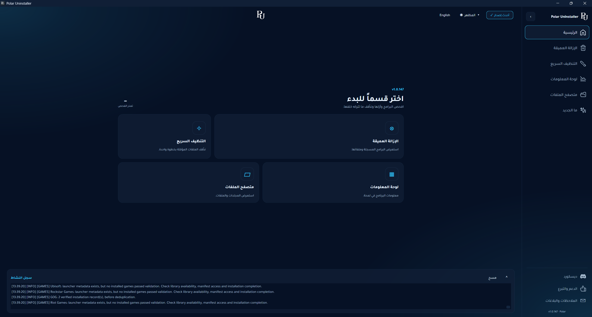

<p align="center">
  
</p>

# Polar Uninstaller

[English](#english) · [العربية](#العربية)

## English

### Overview

Polar Uninstaller is a C# / WPF utility for 64-bit Windows 10 and 11. It removes apps and games, cleans temporary files, analyzes storage, and manages files. The interface supports English and Arabic, including right-to-left layout.



### Using Polar Uninstaller

- **Deep Uninstaller.** Search, sort, or filter the inventory. Select one or more entries and choose **Deep Uninstall** or **Games Uninstall**. Polar chooses a supported removal route, monitors the outcome, and checks eligible leftovers. Some routes require you to finish in the launcher. **Advanced Deep Removal** is available for eligible incomplete attempts.
- **Quick Cleaner.** User Temp and System Temp are selected by default. Prefetch, Recycle Bin, broken shortcuts, and standby RAM are optional. Category choices are saved.
- **Dashboard.** See drive usage, installed program count, space freed, and recent removals. Scan a folder to list its largest files and folders. **Refresh** updates the view. **Clear Cache** resets saved scans, dashboard statistics, and uninstall history after confirmation. It does not delete files listed in the scan results.
- **File Browser.** Navigate with breadcrumbs and history, search and sort the current folder, and calculate folder sizes. The right-click menu offers opening items or their location, copying paths, moving to the Recycle Bin, and permanent deletion.
- **Find Duplicate Files.** Open it from the File Browser’s **…** menu. It compares file contents in the chosen folder and its subfolders. **Smart select** marks extra copies and protects one copy per group. Review the selection before cleaning up.
- **Preferences and updates.** Preview and choose from 12 themes in the Appearance gallery. The update button checks for compatible releases and opens Update Center for an available update.

Use **?** or **F1** outside a text field for shortcut help in File Browser and Duplicate Finder. **Ctrl+F** focuses search. With the results list focused, **Ctrl+A** selects all and **Ctrl+D** or **Esc** clears the selection. **Delete** moves selected items to the Recycle Bin, and **Shift+Delete** requests permanent deletion.

### What's new in v1.0.152

- Deep Uninstall checks both Windows Start Menu Programs folders and both desktops for verified leftover shortcuts, including MSI shortcuts matched by product code.
- Deep Uninstall verifies shortcut removal, clears empty application-specific Start Menu folders, and notifies Windows of both changes.
- Large game removals get more time across supported launchers and are checked more frequently after installation records or files go away. Epic file verification updates progress without flooding the interface.
- Quick Cleanup finds broken shortcuts backed by verified uninstall history and lets you review them before removal.
- Quick Cleanup measures standby RAM and can release it on request. RAM results are reported separately from disk space.
- The theme background extends behind the unified title bar, which places language, theme, and update controls beside the window controls.

See [GitHub Releases](https://github.com/Ayh-m1/Polar-Uninstaller/releases) for older versions.

### Download and run

Download the latest C# / WPF release from the [Releases page](https://github.com/Ayh-m1/Polar-Uninstaller/releases):

| File | How to run |
| --- | --- |
| `PolarUninstaller.exe` | Run the standalone portable executable directly. |
| `PolarUninstaller-Setup-v1.0.152.exe` | Run Setup to install. |

The app includes the required runtime and asks for administrator permission, so Windows shows a User Account Control prompt. Releases are not code-signed yet, so Windows SmartScreen may warn you the first time you run a file. Verify your download first. Older Python releases are separate builds.

To verify a download, run `Get-FileHash -Algorithm SHA256 -LiteralPath '.\PolarUninstaller.exe'` in PowerShell (use the name of the file you downloaded) and compare the result with the matching entry in `SHA256SUMS.txt` from the same release.

### Safety and limitations

- Back up important data and review selected files, folders, shortcuts, and Registry entries before deletion. Prefer the Recycle Bin to permanent deletion.
- A matching name or publisher does not prove ownership, and identical contents do not make a backup disposable. Avoid removing shared game libraries, Windows components, drivers, and security software.
- A closed uninstaller or incomplete scan does not establish that removal succeeded. Review the outcome in the Activity Log.

### Credits

**Developer:** [Polar](https://github.com/Ayh-m1).

**Special thanks to [MobV2](https://github.com/MobV2), lead beta tester,** for extensive testing and detailed feedback that helped improve Polar Uninstaller.

**License:** [MIT](LICENSE).

### Links

[Report an issue](https://github.com/Ayh-m1/Polar-Uninstaller/issues) · [Support](https://polarwolves.com/supportus/p1682342912) · [Discord](https://discord.gg/plr)

### Code signing policy

The project is applying for free code signing through SignPath. If approved, official releases will be signed through SignPath.io with a certificate issued to SignPath Foundation. Ayh-m1 is the author, maintainer, reviewer, and signing approver.

### Privacy Policy

Removal, cleanup, file browsing, and storage analysis run locally. Settings, activity counters, and diagnostics are stored on the device. Update checks and downloads contact GitHub, which may receive standard connection information. **Feedback & Reports** sends the selected category, message, and app version to the feedback service when you choose **Send**. [Privacy policy](PRIVACY.md)

### Build and Signing Process

Use Windows x64, the .NET 9 SDK, and PowerShell. From the repository root:

```powershell
cd .\Polar-Uninstaller-WPF
dotnet restore .\PolarUninstallerWpf.csproj -p:PublishProfile=WindowsSingleFile
.\Build-SingleFile.ps1
```

The standalone output is `Build/SingleFile/PolarUninstaller.exe`. Setup is built with NSIS using `Installer-NSIS/PolarUninstaller.nsi`.

GitHub Actions builds and checks the Windows EXE and Setup, then uploads both with their checksums. Signing requests require manual approval if the SignPath application is approved.

---

## العربية

### نظرة عامة

أداة لإزالة البرامج والألعاب، وتنظيف الملفات المؤقتة، وتحليل مساحة التخزين، وإدارة الملفات. تعمل على ويندوز ⁦10⁩ و⁦11⁩ بمعمارية ⁦x64⁩، ومبنية باستخدام ⁦C#⁩ و⁦WPF⁩. تدعم الإنجليزية والعربية، مع عرض الواجهة العربية من اليمين إلى اليسار.


### استخدام البرنامج

- **الإزالة العميقة.** ابحث عن البرامج والألعاب ورتّب القائمة وصفِّها. حدّد عنصرًا أو أكثر واختر **الإزالة العميقة** أو **إزالة الألعاب**. يختار البرنامج مسار الإزالة المناسب ويتابع نتيجته ويفحص البقايا المؤهلة. قد تحتاج إلى إكمال بعض عمليات الإزالة داخل مشغّل اللعبة. يظهر خيار **الإزالة العميقة المتقدمة** للمحاولات غير المكتملة التي تدعمه.
- **التنظيف السريع.** ملفات المستخدم والنظام المؤقتة محددة افتراضيًا. يمكنك أيضًا اختيار ملفات ⁦Prefetch⁩ وسلة المحذوفات والاختصارات المعطلة وذاكرة الاستعداد. يحفظ البرنامج اختياراتك.
- **لوحة المعلومات.** تعرض استخدام الأقراص وعدد البرامج المثبّتة والمساحة المحرّرة وآخر عمليات الإزالة. افحص مجلدًا لعرض أكبر ملفاته ومجلداته. يحدّث زر **تحديث** البيانات. ويعيد خيار **إزالة الكاش** ضبط الفحوص المحفوظة والإحصاءات وسجل الإزالة بعد التأكيد، من دون حذف الملفات الظاهرة في النتائج.
- **متصفح الملفات.** تنقّل عبر مسار المجلد وسجل الرجوع، وابحث داخل المجلد الحالي ورتّب محتوياته واحسب أحجام المجلدات. من قائمة الزر الأيمن يمكنك فتح العناصر أو مواقعها، ونسخ المسارات، والنقل إلى سلة المحذوفات أو الحذف النهائي.
- **البحث عن الملفات المكررة.** افتحه من قائمة **…** في متصفح الملفات. يقارن محتوى الملفات داخل المجلد المحدد ومجلداته الفرعية. يحدد **التحديد الذكي** النسخ الزائدة ويحمي نسخة واحدة في كل مجموعة. راجع التحديد قبل التنظيف.
- **المظهر والتحديثات.** عاين واختر من بين 12 مظهرًا في معرض المظاهر. يتحقق زر التحديث من الإصدارات المتوافقة، ويفتح مركز التحديث عند توفر إصدار جديد.

تجد مساعدة الاختصارات في متصفح الملفات والبحث عن المكررات عبر زر **?** أو مفتاح ⁦F1⁩ خارج حقول النص. استخدم ⁦Ctrl+F⁩ للانتقال إلى البحث. عندما تكون قائمة النتائج نشطة، يحدد ⁦Ctrl+A⁩ الكل، ويلغي ⁦Ctrl+D⁩ أو ⁦Esc⁩ التحديد. ينقل ⁦Delete⁩ العناصر المحددة إلى السلة، ويطلب ⁦Shift+Delete⁩ حذفها نهائيًا.

### ما الجديد في ⁦v1.0.152⁩

- تفحص الإزالة العميقة مجلدات البرامج في قائمة ابدأ وسطح المكتب للمستخدم ولجميع المستخدمين. ويطابق ⁦Polar⁩ اختصارات ⁦MSI⁩ مع معرّف المنتج.
- تتحقق الإزالة العميقة من حذف الاختصارات، وتزيل مجلدات قائمة ابدأ الفارغة الخاصة بالبرنامج، وتخطر ⁦Windows⁩ بالتغييرين.
- تحصل إزالة الألعاب الكبيرة على مهلة أطول في المشغّلات المدعومة، ويزداد معدّل التحقق بعد زوال سجل التثبيت أو الملفات. ويُعرض تقدّم فحص ملفات ⁦Epic⁩ دون إغراق الواجهة بالتحديثات.
- يعثر التنظيف السريع على الاختصارات المعطلة التي يثبت سجل الإزالة ارتباطها ببرنامج أُزيل، ويتيح مراجعتها قبل الحذف.
- يقيس التنظيف السريع ذاكرة الاستعداد ويحررها عند الطلب، ويعرض نتيجتها بشكل مستقل عن مساحة القرص.
- تمتد خلفية المظهر خلف شريط العنوان الموحّد، الذي يجمع أزرار اللغة والمظهر والتحديث مع أزرار التحكم بالنافذة.

راجع [إصدارات GitHub](https://github.com/Ayh-m1/Polar-Uninstaller/releases) للاطلاع على الإصدارات السابقة.

### التحميل والتشغيل

نزّل أحدث إصدار ⁦C# / WPF⁩ من [صفحة الإصدارات](https://github.com/Ayh-m1/Polar-Uninstaller/releases):

- ⁦`PolarUninstaller.exe`⁩ — ملف تنفيذي محمول ومستقل، شغّله مباشرة.
- ⁦`PolarUninstaller-Setup-v1.0.152.exe`⁩ — شغّله لتثبيت البرنامج.

يتضمن البرنامج بيئة التشغيل المطلوبة، ويطلب صلاحيات المسؤول، لذلك ستظهر نافذة التحكم بحساب المستخدم (⁦UAC⁩). الإصدارات غير موقّعة رقميًا بعد، فقد يعرض ⁦Windows SmartScreen⁩ تحذيرًا عند أول تشغيل، فتحقق من الملف قبل تشغيله. إصدارات ⁦Python⁩ القديمة منفصلة عن هذه النسخة.

للتحقق من التنزيل، نفّذ في ⁦PowerShell⁩ الأمر ⁦`Get-FileHash -Algorithm SHA256 -LiteralPath '.\PolarUninstaller.exe'`⁩ مع اسم الملف الذي نزّلته، ثم قارن البصمة بالسطر المطابق في ملف ⁦`SHA256SUMS.txt`⁩ من نفس الإصدار.

### الأمان والقيود

- انسخ بياناتك المهمة احتياطيًا وراجع الملفات والمجلدات والاختصارات ومفاتيح ⁦Registry⁩ قبل الحذف. استخدم سلة المحذوفات متى أمكن.
- تطابق اسم البرنامج أو الناشر لا يكفي لإثبات ملكية الملفات، وتطابق المحتوى لا يعني أن النسخة الاحتياطية غير لازمة. تجنّب إزالة مكتبات الألعاب المشتركة ومكونات ويندوز وبرامج التشغيل والحماية.
- إغلاق مزيل التثبيت أو انتهاء فحص غير مكتمل لا يثبت نجاح الإزالة. راجع النتيجة في سجل النشاط.

### الشكر والتقدير

**المطوّر:** [Polar](https://github.com/Ayh-m1).

**شكر خاص لـ [MobV2](https://github.com/MobV2)، المختبر الرئيسي للبرنامج،** على تجربته الواسعة وملاحظاته المفصلة التي ساعدت في تحسين Polar Uninstaller.

**الترخيص:** [MIT](LICENSE).

### روابط

[الإبلاغ عن مشكلة](https://github.com/Ayh-m1/Polar-Uninstaller/issues) · [الدعم](https://polarwolves.com/supportus/p1682342912) · [Discord](https://discord.gg/plr)

### سياسة التوقيع الرقمي

يتقدّم المشروع للحصول على خدمة التوقيع المجانية من ⁦SignPath⁩. إذا قُبل الطلب، ستُوقّع الإصدارات الرسمية عبر ⁦SignPath.io⁩ بشهادة صادرة إلى ⁦SignPath Foundation⁩. يتولى ⁦Ayh-m1⁩ تطوير المشروع ومراجعته والموافقة على طلبات توقيعه.

### سياسة الخصوصية

تتم الإزالة والتنظيف وتصفح الملفات وتحليل التخزين على جهازك. وتُحفظ الإعدادات وعدادات النشاط وبيانات التشخيص محليًا. يتصل البرنامج بـ ⁦GitHub⁩ للتحقق من التحديثات وتنزيلها، وقد يتلقى الموقع بيانات الاتصال المعتادة. عند الضغط على **إرسال** في نافذة الملاحظات والبلاغات، تُرسل فئة البلاغ ونصه وإصدار البرنامج إلى خدمة الملاحظات. [سياسة الخصوصية](PRIVACY.md)

### البناء والتوقيع

تحتاج إلى ويندوز ⁦x64⁩ و⁦.NET 9 SDK⁩ و⁦PowerShell⁩. شغّل الأوامر من جذر المستودع:

```powershell
cd .\Polar-Uninstaller-WPF
dotnet restore .\PolarUninstallerWpf.csproj -p:PublishProfile=WindowsSingleFile
.\Build-SingleFile.ps1
```

ينتج الملف المستقل في ⁦`Build/SingleFile/PolarUninstaller.exe`⁩. يُبنى برنامج التثبيت باستخدام ⁦NSIS⁩ وملف ⁦`Installer-NSIS/PolarUninstaller.nsi`⁩.

يبني ⁦GitHub Actions⁩ الملف التنفيذي والمثبّت ويتحقق منهما، ثم يرفعهما مع بصماتهما ضمن مخرجات البناء. إذا قُبل طلب ⁦SignPath⁩، فستتطلب طلبات التوقيع موافقة يدوية.
